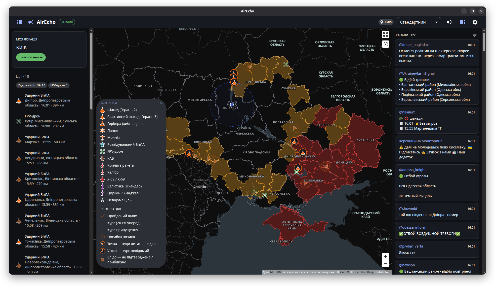

# AirEcho

Десктопний застосунок (Ubuntu, Windows): повітряні тривоги та цілі в реальному часі на карті, стрічка моніторингових каналів і **власна озвучка** подій через пресети.



> Дані: [NEPTUN](https://neptun.in.ua). AirEcho, як і NEPTUN, **не є офіційною системою оповіщення**: дані можуть бути неточними або із запізненням. Завжди орієнтуйтеся на офіційні сигнали тривоги.

## Можливості

- Три колонки: тривоги й цілі, карта (CARTO Positron / Dark Matter), повідомлення каналів (клік відкриває канал у Telegram).
- Локації: кілька збережених, активна одна. Для кожної задаються точка й радіус для цілей.
- Озвучка пресетами. Звук можна прив'язати до:
  - початку тривоги та відбою в активній локації;
  - кожного типу цілі NEPTUN у радіусі;
  - ключових слів у вибраних каналах.
  Звук записується мікрофоном або завантажується файлом (mp3, ogg, wav, webm, m4a).
- Експорт та імпорт пресетів: файл `.airecho` (zip з `manifest.json` і `audio/`).
- Світла, темна або системна тема. Застосунок згортається в трей і продовжує стежити.

## Розробка

```bash
npm install
npm run dev        # запуск з HMR
npm test           # тести рушія озвучки та імпорту пресетів
npm run dist:linux # AppImage у dist/
npm run dist:win   # інсталятор NSIS (на Windows)
```

Стандартні сигнали в `resources/default-preset` згенеровано скриптом `scripts/make_assets.py`. Вони вільні від прав (CC0).

## Формат пресета

```json
{
  "format": "airecho-preset",
  "version": 1,
  "id": "…",
  "name": "Мій пресет",
  "tracks": [
    { "id": "t1", "trigger": { "kind": "threat", "type": "ballistic" }, "file": "audio/t1.webm" },
    { "id": "t2", "trigger": { "kind": "keyword", "channels": ["@kpszsu"], "keywords": ["вибух"] }, "file": "audio/t2.mp3" },
    { "id": "t3", "trigger": { "kind": "alertStart" }, "file": "audio/t3.wav" }
  ]
}
```

Типи цілей: `ballistic`, `missile`, `kab`, `mig31k`, `uav`, `recon`, `fpv`, `unknown`.

## Ліцензія

MIT
